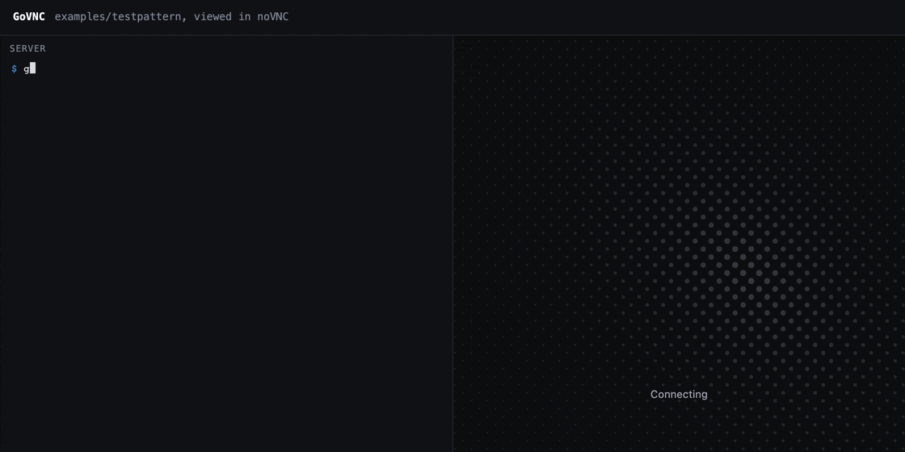

<h1 align="center">GoVNC</h1>

<p align="center">
  
</p>

<p align="center">
  <strong>A pure-Go VNC (RFB) server library. Bring your own pixels.</strong>
</p>

<p align="center">
  <a href="https://pkg.go.dev/github.com/anchorbrowser/govnc"></a>
  <a href="https://github.com/anchorbrowser/GoVNC/actions/workflows/ci.yml"></a>
  <a href="https://goreportcard.com/report/github.com/anchorbrowser/govnc"></a>
  <a href="LICENSE"></a>
</p>

---

GoVNC lets any Go program be watched and driven from a standard VNC viewer, in the browser with
noVNC or from a desktop client. You publish frames. GoVNC handles the protocol: handshake,
encodings, pixel formats, clipboard and back-pressure. It hands you each viewer's keyboard,
pointer and clipboard input through hooks.

It does **no screen capture and no input injection**, so it runs the same on Linux, macOS and
Windows. What the picture is (a headless browser, a game, a simulation, a remote screen) and what
input does with it is up to you.

GoVNC was built at [Anchor Browser](https://anchorbrowser.io) to stream live browser sessions.

## Why GoVNC

Most VNC servers are programs tied to one OS's screen. Most Go VNC libraries are clients. GoVNC is
a server you embed, and it does not care where the pixels come from.

- **Runs on any OS.** No cgo and no OS APIs. Building with `CGO_ENABLED=0` gives one static binary
  for Linux, macOS or Windows, on amd64 or arm64. It also runs in a `scratch` container.
- **Agnostic to the source.** GoVNC never captures a screen. A headless browser, an emulator, a game
  loop, a robot camera or a rendered dashboard all look the same to it: a frame in, input out.
- **A library, not a daemon.** There is no separate VNC server to install, configure and supervise
  next to your app. Your program is the VNC server, with your logging, your auth and your
  lifecycle.
- **Browser-ready without a proxy.** `ServeConn` speaks RFB over any stream. Serve noVNC straight
  from your HTTP handler over a WebSocket, with no websockify.
- **Fast with sources that already produce JPEG.** Chrome's screencast and many cameras already
  produce JPEG. GoVNC sends those bytes straight to the viewer, so there is no decode and re-encode
  per frame.
- **Safe to expose to untrusted input.** Parsers are bounded, timeouts are enforced, and the default
  security is documented plainly, so there is no false sense of safety.

## Features

- **Zero dependencies.** Standard library only.
- **JPEG pass-through.** Publish a JPEG and every viewer that supports Tight gets the exact bytes,
  with no re-encode. Other viewers get it decoded once, shared across viewers, and converted to
  their pixel format.
- **Latest frame wins.** `Publish` never blocks. A slow viewer gets the newest frame when it asks,
  so nothing queues and memory stays flat.
- **Any transport.** `Serve` takes a `net.Listener`. `ServeConn` takes any `io.ReadWriteCloser`:
  TCP, WebSocket, an SSH or yamux stream, or `net.Pipe` in tests.
- **Input hooks with consume semantics.** Key, pointer and clipboard handlers run in order until
  one returns `true`. A chain like "menu first, then shortcuts, then default" is just a list.
- **Push to viewers.** Send clipboard text, draw overlays (menus, badges, cursors) over the frame,
  force a full refresh, or resize by publishing a frame of a new size.
- **Hardened for untrusted clients.** Every length field is capped before allocation, compressed
  clipboard payloads are size-limited, and handshake and write timeouts close stalled viewers.
  You can also limit the number of sessions.

## Install

```sh
go get github.com/anchorbrowser/govnc
```

Requires Go 1.24 or newer.

## Quick start

A server that shows a solid colour and logs every key press:

```go
package main

import (
	"bytes"
	"context"
	"image"
	"image/color"
	"image/draw"
	"image/jpeg"
	"log"
	"net"

	"github.com/anchorbrowser/govnc"
	"github.com/anchorbrowser/govnc/rfb"
)

func main() {
	srv, err := govnc.NewServer(govnc.Options{
		Name: "hello",
		OnSession: func(s *govnc.Session) govnc.Hooks {
			return govnc.Hooks{Key: []govnc.KeyHandler{func(_ context.Context, ev rfb.KeyEvent) bool {
				log.Printf("%s: key %#x down=%v", s.RemoteAddr(), ev.Keysym, ev.Down)
				return true
			}}}
		},
	})
	if err != nil {
		log.Fatal(err)
	}

	img := image.NewRGBA(image.Rect(0, 0, 320, 200))
	draw.Draw(img, img.Bounds(), &image.Uniform{C: color.RGBA{R: 0x20, G: 0x60, B: 0xc0, A: 0xff}}, image.Point{}, draw.Src)
	var buf bytes.Buffer
	if err := jpeg.Encode(&buf, img, nil); err != nil {
		log.Fatal(err)
	}
	srv.Publish(govnc.Frame{JPEG: buf.Bytes()})

	ln, err := net.Listen("tcp", "127.0.0.1:5900")
	if err != nil {
		log.Fatal(err)
	}
	log.Fatal(srv.Serve(context.Background(), ln))
}
```

Point any VNC viewer at `127.0.0.1:5900`.

For a complete program, see [`examples/testpattern`](examples/testpattern). It shows a moving test
pattern, logs keys and clicks, and echoes the clipboard back:

```sh
go run ./examples/testpattern -addr 127.0.0.1:5900
go run ./examples/testpattern -addr 127.0.0.1:5900 -password secret   # with VNC Authentication
```

[`examples/stdio`](examples/stdio) turns any process into a VNC server: it publishes an MJPEG
stream from stdin and writes viewer input to stdout as JSON lines. Below, a headless browser's
screencast is piped through it, and the click and keys from the viewer come back out and land in
the browser:

<p align="center">
  
</p>

## How it works

### Frames

Call `Server.Publish` whenever the picture changes. A `Frame` carries either a `JPEG` or an
`image.Image`:

| You publish | Tight viewers get | Other viewers get |
| --- | --- | --- |
| `Frame{JPEG: b}` | the JPEG bytes as they are | the JPEG decoded once, sent as Raw |
| `Frame{Image: img}` | Raw | Raw, or RRE if the viewer prefers it |

Publish a JPEG for photographic content such as browsers and video. Use an `image.Image` for flat
UI where RRE compresses well. A frame with a new size resizes every viewer that supports
DesktopSize.

### Sessions and hooks

`Options.OnSession` runs once per viewer, after the handshake. It returns that viewer's `Hooks`:

```go
OnSession: func(s *govnc.Session) govnc.Hooks {
	return govnc.Hooks{
		Key:       []govnc.KeyHandler{menuKeys, shortcuts, forwardKey},
		Pointer:   []govnc.PointerHandler{menuClicks, forwardPointer},
		Clipboard: []govnc.ClipboardHandler{storeClipboard},
		Closed:    func(err error) { log.Printf("%s left: %v", s.RemoteAddr(), err) },
	}
},
```

Each chain stops at the first handler that returns `true`.

### Pushing to viewers

```go
srv.SetClipboard("copied on the host")  // every viewer
s.SendClipboard("just this viewer")     // one session, from OnSession or a hook
s.SetOverlays(func(fb image.Rectangle) image.Image { return badge }) // drawn over the frame
s.SetOverlays()                         // none: the frame underneath is repainted
srv.Refresh()                           // full repaint for every viewer
```

An overlay returns an image placed at its own bounds, clipped to the framebuffer. It stays on
screen across frames until you replace it.

### Transports

`ServeConn` serves one viewer over any `io.ReadWriteCloser`. Use it to serve noVNC over a WebSocket
(here with [`github.com/coder/websocket`](https://github.com/coder/websocket)):

```go
http.HandleFunc("/vnc", func(w http.ResponseWriter, r *http.Request) {
	c, err := websocket.Accept(w, r, &websocket.AcceptOptions{Subprotocols: []string{"binary"}})
	if err != nil {
		return
	}
	_ = srv.ServeConn(r.Context(), websocket.NetConn(r.Context(), c, websocket.MessageBinary))
})
```

The same pattern works for SSH channels, multiplexed tunnel streams, and `net.Pipe` in tests.

## Security

> [!WARNING]
> **There is no authentication by default.** The default security type is None: anyone who can
> reach the port can see the screen and send input.

- Bind to `127.0.0.1`, or put the connection behind something that authenticates and encrypts:
  TLS, an authenticated WebSocket, or an SSH or other tunnel. `ServeConn` takes any
  `io.ReadWriteCloser`, so you choose the transport.
- `rfb.VNCAuth` is classic VNC Authentication. It is **weak**: it uses DES, only the first 8 bytes
  of the password count, and nothing on the wire is encrypted. It exists so standard clients that
  insist on a password can connect. Do not rely on it to protect anything.

  ```go
  srv, err := govnc.NewServer(govnc.Options{
  	Security: []rfb.SecurityType{rfb.VNCAuth{Password: "secret"}},
  })
  ```

- To add your own scheme, implement `rfb.SecurityType` (a type number and an `Authenticate`
  exchange) and list it in `Options.Security`.

Every viewer gets input. On anything other people can reach, set `MaxSessions`,
`HandshakeTimeout` and `WriteTimeout`.

To report a vulnerability, use GitHub's
[private vulnerability reporting](https://github.com/anchorbrowser/GoVNC/security/advisories/new)
instead of opening a public issue.

## Protocol support

| Area | Supported |
| --- | --- |
| Versions | RFB 3.3, 3.7, 3.8 |
| Security | None, VNC Authentication, custom `rfb.SecurityType` |
| Encodings | Tight (JPEG), Raw, RRE |
| Pseudo-encodings | DesktopSize, Cursor, Extended Clipboard |
| Clipboard | Extended Clipboard (UTF-8), classic cut text (Latin-1) |
| Pixel formats | Any true-colour format at 8, 16 or 32 bpp |

Tested against noVNC. Not supported: ZRLE, Hextile and other zlib-based encodings (Tight JPEG
covers photographic content and RRE covers flat drawings), and a client implementation.

## Packages

| Package | Purpose |
| --- | --- |
| [`govnc`](https://pkg.go.dev/github.com/anchorbrowser/govnc) | The server: `Server`, `Session`, `Options`, `Frame`, `Hooks`, `Overlay`, `Cursor`. |
| [`govnc/rfb`](https://pkg.go.dev/github.com/anchorbrowser/govnc/rfb) | The wire protocol with no I/O scheduling: handshake, security types, client messages, encoders and clipboard format. Use it on its own for proxies or test clients. |

## Contributing

Issues and pull requests are welcome. Before you open a PR:

```sh
gofmt -l .
go vet ./...
golangci-lint run
go test -race ./...
```

CI runs the same checks on Linux, macOS and Windows.

## License

Apache License 2.0. Copyright 2026 Anchor Browser. See [LICENSE](LICENSE).
